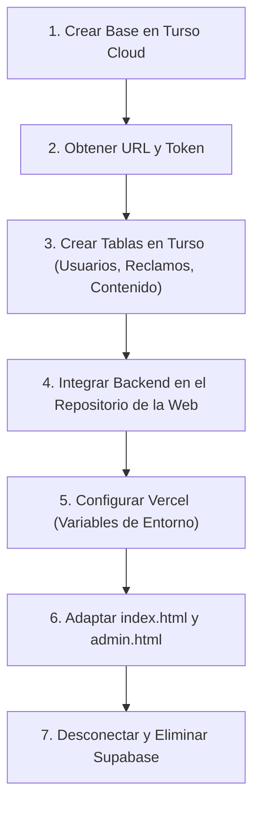

# 🚀 Guía de Migración: De Supabase a Turso Cloud (GitHub + Vercel)
## Proyecto: Barrio Del Carmen · Río Gallegos

Esta guía detalla paso a paso cómo reemplazar **Supabase** por **Turso Cloud (libSQL)** y desplegar el nuevo backend y panel de administración en **Vercel** sin costo ($0/mes), aprovechando el paquete `gestor_usuarios_turso.zip` y el instructivo de autenticación.

---

## 📌 ¿Por qué este cambio soluciona los problemas de Supabase?

1. **Sin pausas por inactividad:** Supabase pausa las bases de datos gratuitas tras 7 días sin uso. Turso **nunca se pausa** y ofrece 500 bases de datos y 9 GB gratis permanentes.
2. **Arquitectura simple y robusta:** En lugar de lidiar con políticas complejas de RLS en el navegador, el backend en Python (Flask Serverless) controla los accesos y la seguridad en el servidor.
3. **Gestor de usuarios completo:** Incluye roles (`admin`, `operador`, `auditor`), recuperación de acceso por **PIN temporal** y mensajes listos para **WhatsApp Web**.
4. **Despliegue unificado en Vercel:** Tu frontend estático y tu backend de API conviven en el mismo repositorio de GitHub y en el mismo proyecto de Vercel.

---

## 🗺️ Mapa de la Migración



---

## PASO 1: Crear la Base de Datos en Turso Cloud

1. Entrá a [https://turso.tech/](https://turso.tech/) e iniciá sesión (podés usar tu cuenta de GitHub).
2. Hacé clic en **"Create Database"**.
3. Poné un nombre descriptivo, por ejemplo: `barrio-del-carmen`.
4. Elegí la región más conveniente (por ejemplo, `gcp-sa-east1` en San Pablo o `aws-us-east-1`).
5. Hacé clic en **"Create Database"**.
6. En el panel de la base de datos:
   - Copiá la **Database URL** (empieza con `https://barrio-del-carmen-...turso.io`).
   - Ve a la pestaña **Tokens**, hacé clic en **"Generate Token"** y copiá el Token JWT largo.
   *(Guardá ambos datos temporalmente en un bloc de notas seguro).*

---

## PASO 2: Crear las Tablas en Turso

Desde la web de Turso, entrá a la pestaña **SQL Editor** de tu base de datos y ejecutá este script para crear todas las tablas necesarias:

```sql
-- 1. Tabla de Usuarios y Operadores
CREATE TABLE IF NOT EXISTS usuarios (
    id INTEGER PRIMARY KEY AUTOINCREMENT,
    usuario TEXT NOT NULL UNIQUE COLLATE NOCASE,
    hash_clave TEXT NOT NULL,
    nombre TEXT NOT NULL,
    rol TEXT NOT NULL DEFAULT 'operador',
    area TEXT,
    email TEXT,
    telefono TEXT,
    activo INTEGER NOT NULL DEFAULT 1,
    debe_cambiar_clave INTEGER NOT NULL DEFAULT 0,
    intentos_fallidos INTEGER NOT NULL DEFAULT 0,
    bloqueado_hasta TEXT,
    pin_hash TEXT,
    pin_expira_en TEXT,
    pin_intentos INTEGER NOT NULL DEFAULT 0,
    creado_en TEXT NOT NULL DEFAULT (datetime('now', 'utc'))
);

CREATE INDEX IF NOT EXISTS idx_usuarios_usuario ON usuarios(usuario);

-- 2. Tabla de Auditoría
CREATE TABLE IF NOT EXISTS auditoria (
    id INTEGER PRIMARY KEY AUTOINCREMENT,
    usuario_id INTEGER,
    usuario TEXT NOT NULL,
    nombre_usuario TEXT,
    rol TEXT,
    accion TEXT NOT NULL,
    entidad TEXT NOT NULL,
    entidad_id TEXT,
    detalle TEXT NOT NULL,
    ip TEXT,
    creado_en TEXT NOT NULL DEFAULT (datetime('now', 'utc'))
);

-- 3. Tabla de Reclamos y Avisos Vecinales (Reemplaza a Supabase)
CREATE TABLE IF NOT EXISTS reclamos (
    id INTEGER PRIMARY KEY AUTOINCREMENT,
    fecha_problema TEXT NOT NULL,
    hora_problema TEXT NOT NULL,
    zona TEXT NOT NULL,
    tema TEXT NOT NULL,
    descripcion TEXT NOT NULL,
    estado TEXT NOT NULL DEFAULT 'recibida',
    creado_en TEXT NOT NULL DEFAULT (datetime('now', 'utc'))
);

CREATE INDEX IF NOT EXISTS idx_reclamos_estado ON reclamos(estado);
CREATE INDEX IF NOT EXISTS idx_reclamos_creado_en ON reclamos(creado_en);

-- 4. Tabla de Contenido Dinámico de la Web
CREATE TABLE IF NOT EXISTS contenido_sitio (
    clave TEXT PRIMARY KEY,
    valor TEXT NOT NULL,
    actualizado_en TEXT NOT NULL DEFAULT (datetime('now', 'utc'))
);

INSERT INTO contenido_sitio (clave, valor) VALUES
('intro', 'Este es un punto de encuentro para quienes viven y trabajan en el barrio. Queremos compartir información útil, celebrar lo que hacemos juntos y encontrar soluciones entre todos.'),
('history', 'La historia de Nuestra Señora del Carmen se sumará próximamente con el aporte de sus vecinos.'),
('extra_text', ''),
('hero_image', '')
ON CONFLICT (clave) DO NOTHING;
```

---

## PASO 3: Estructura del Repositorio para Vercel

Para que Vercel sirva tanto la página pública como la API de administración en el mismo proyecto, la estructura de la carpeta debe quedar organizada de la siguiente manera:

```text
barrio del carmen/
├── index.html              <-- Página pública
├── styles.css              <-- Estilos de la página pública
├── app.js                  <-- Lógica pública (apunta a /api/reclamos y /api/contenido)
├── admin.html              <-- Panel de administración
├── admin.css               <-- Estilos del panel
├── admin.js                <-- Lógica del panel (apunta a /api/admin/* y /api/auth/*)
├── vercel.json             <-- Configuración de Vercel para Serverless Python
├── requirements.txt        <-- Dependencias de Python para Vercel
├── api/
│   ├── index.py            <-- Entrada WSGI de Vercel
│   ├── app.py              <-- Aplicación Flask
│   ├── config.py           <-- Lectura de variables de entorno
│   ├── db.py               <-- Conexión HTTP nativa a Turso (/v2/pipeline)
│   ├── seguridad.py        <-- Hashing Argon2 y contraseñas
│   ├── sesiones.py         <-- Manejo de cookies seguras
│   ├── credenciales.py     <-- Generación de PIN y links de WhatsApp
│   ├── auditoria.py        <-- Registro inmutable
│   ├── rutas_auth.py       <-- Login, logout, cambio de clave, PIN
│   ├── rutas_admin.py      <-- CRUD de usuarios y auditoría
│   ├── rutas_reclamos.py   <-- Gestión de avisos y quejas
│   └── rutas_contenido.py  <-- Edición de textos del barrio
```

### Contenido de `requirements.txt`:
```text
Flask>=3.0.0
argon2-cffi>=23.1.0
python-dotenv>=1.0.0
```

### Contenido de `vercel.json`:
```json
{
  "version": 2,
  "builds": [
    {
      "src": "api/index.py",
      "use": "@vercel/python"
    }
  ],
  "routes": [
    {
      "src": "/api/(.*)",
      "dest": "api/index.py"
    },
    {
      "src": "/(.*)",
      "dest": "/$1"
    }
  ]
}
```

---

## PASO 4: Endpoints de la Nueva API

El nuevo backend resolverá todo lo que antes hacía Supabase:

| Método | Endpoint | Acceso | Descripción |
|---|---|---|---|
| `GET` | `/api/contenido` | Público | Devuelve los textos de la página (intro, historia). |
| `POST` | `/api/reclamos` | Público | Envía un aviso/queja anónimo con validación antispam. |
| `POST` | `/api/auth/iniciar-sesion` | Público | Login de administrador/operador con cookies HttpOnly. |
| `POST` | `/api/auth/cerrar-sesion` | Operador | Cierra la sesión activa. |
| `GET` | `/api/auth/sesion` | Operador | Verifica si hay una sesión abierta. |
| `GET` | `/api/admin/reclamos` | Admin / Operador | Lista de reclamos con filtros de fecha, tema y estado. |
| `PATCH` | `/api/admin/reclamos/<id>` | Admin / Operador | Actualiza el estado del reclamo (recibida, en gestión, resuelta). |
| `POST` | `/api/admin/contenido` | Admin | Modifica los textos de la página. |
| `GET` | `/api/admin/operadores` | Admin | Gestiona usuarios del sistema. |
| `POST` | `/api/admin/operadores/<id>/pin` | Admin | Genera PIN temporal y enlace de WhatsApp Web. |

---

## PASO 5: Configuración en Vercel (Variables de Entorno)

1. En tu proyecto de [Vercel](https://vercel.com):
2. Ve a **Settings > Environment Variables**.
3. Agregá las siguientes variables:
   * `TURSO_DATABASE_URL`: Tu URL copiada de Turso (ej: `https://barrio-del-carmen-tunombre.turso.io`).
   * `TURSO_AUTH_TOKEN`: El token JWT largo generado en Turso.
   * `SECRET_KEY`: Una cadena segura aleatoria de al menos 32 caracteres para firmar las cookies.
   * `COOKIE_SECURE`: `true` (para HTTPS en Vercel).
4. Guarda las variables y haz un nuevo **Redeploy** en Vercel.

---

## PASO 6: Limpieza y Eliminación de Supabase

Una vez implementada la nueva estructura:
1. **Eliminar archivos obsoletos:**
   - Borrar `config.js` (ya no hace falta exponer credenciales en el cliente).
   - Borrar `setup_supabase.sql`.
   - Borrar `reset-password.html` y `reset-password.js` (reemplazados por el flujo de PIN y WhatsApp).
2. **En `index.html` y `admin.html`:**
   - Quitar la etiqueta `<script src="https://cdn.jsdelivr.net/npm/@supabase/supabase-js@2"></script>`.
   - Quitar `<script src="config.js"></script>`.
3. **En Supabase:** Ya puedes pausar o borrar el proyecto en supabase.com.

---

## 💡 Próximo paso recomendado

¿Deseas que preparemos ahora mismo la carpeta `api/` con el código adaptado a Turso y ajustemos `app.js` y `admin.js` para dejarlos listos para subir a tu GitHub?
